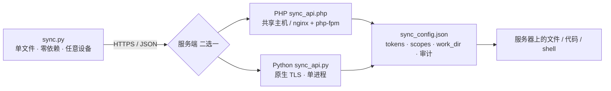

# ai-sync

> **给 AI 用的服务器遥控器。**
>
> 一个零依赖的 Python 文件，把「在服务器上读写文件、改代码、跑命令」变成 **67 个带 JSON 契约的 API**。
> Agent 不用 SSH、不用猜命令输出、不用怕改错——每一步都能**预览、校验、复验、一键回滚**。

**AI 专用 · 跨设备 · 跨平台 · 零依赖**的同步工具：在服务器上装好服务端，任何能跑 Python 的设备——笔记本、手机 Termux、容器、CI runner、另一台服务器——都能远程管理文件、编写并发布代码、运维服务器。

`MIT` · `Python 3.8+` · `67 个 action` · `PHP / Python 双服务端协议等价` · `全部输出机器可读`

---

## 为什么不用 SSH？

给 AI 开 SSH，等于把一段**不可解析、不可撤销、无权限细分**的交互会话交给它。ai-sync 把服务器操作重新设计成适合 Agent 调用的形式：

| | SSH / SFTP / 自建脚本 | ai-sync |
|---|---|---|
| 输出 | 人类文本，靠正则猜 | 恒定 JSON 信封 `{ok, code, stdout, stderr, command}` |
| 能力发现 | 靠人写文档 | 服务端自描述：`{"action":"help"}` / `--api-help` |
| 出错 | 一条命令改坏就得手工救 | `--dry-run` → `lint` → 原子覆盖 + 自动备份 → `--rollback` |
| 权限 | 一个账号全开 | 按 token 分 `read/write/delete/exec/lint/backup/admin`，按 scope 隔离目录 |
| 可追溯 | 靠 `history` | 审计日志 / 操作日志 / 最近变更 / 错误日志 |
| 连续操作 | 每条一次 RTT | `pipeline` 一次往返跑多步，10 步约快 4 倍 |
| 长任务 | 断了就丢 | 持久 shell 会话 + 后台任务轮询（`shell_job`） |

## 30 秒看懂



一次典型的 AI 改码闭环（全是结构化输出，可直接被 Agent 断言）：

```bash
# 0. 第一次接手：让服务端自己说明能做什么，无需读文档
python3 sync.py --api-help

# 1. 找代码 → 读文件（大文件按行切片，不撑爆上下文）
python3 sync.py --search "function save_user"
python3 sync.py --cat app/user.php --brief

# 2. 改完发布：语法预检 → 差异预览 → 原子覆盖 + 自动备份 → md5 复验
python3 sync.py --deploy app/user.php --smart-verify

# 3. 端到端断言（内置抓取，不用另写 curl）
python3 sync.py --http-check "$SITE_URL/health" --expect "OK"

# 4. 改错了？回到改动前
python3 sync.py --backup-list app/user.php
python3 sync.py --rollback app/user.php --backup <备份名> --yes
```

---

## 它能做什么

> 不想敲命令？还有**可视化管理面板** `admin/admin.html`：目录授权、Token 管理、文件浏览、备份回滚、审计日志、远程执行、客户端打包都能在浏览器里完成，见 [docs/ADMIN.md](docs/ADMIN.md)。

### 一、管理文件

| 能力 | 对应机制 |
|---|---|
| 跨设备同步 | md5/sha1 快照增量比对、`--pull-smart` / `--push` / `--watch`（双向监听） |
| 大文件 | `chunked_upload` 分片断点续传、`upload_batch` 批量、gzip、二进制安全、流式下载 |
| 找和看 | `list` / `stat` / `search`（全文带上下文）/ `read_range`（按行带行号）/ `checksum` / `diff` / `sync_check` |
| 改和搬 | `mkdir` / `rename` / `copy` / `delete` / 软链接、`format` |
| 防手滑 | CAS 乐观锁（`expect_md5`）冲突检测、原子覆盖、自动备份、`backup_rb` / `batch_rollback` 按时间点批量回滚 |

### 二、编写代码

AI 改码最怕「改完不知道对不对」，所以发布链路是**闭环**而不是一次覆盖：

`search` → `cat` / `--read-remote`（缓存改 + 冲突检测）→ `--diff` 预览 → `lint` / `lint_batch` → `deploy --smart-verify`（md5 复验）→ `--http-check` 断言 → `--rollback` 兜底。

配套还有 `php_run`（跑服务器上的脚本）、`format`、`snippet_*`（代码片段库）、`todo`（扫 TODO/FIXME）、`stats`（代码统计）、`doc`（生成 API 文档）。服务端写 PHP 文件时会**自动做语法检查**，语法错直接拒绝落盘。

### 三、管理服务器

- **执行**：`exec` 单次命令；`shell_open` + `shell_run` 持久会话，`cd` / `export` 跨调用保持，**对齐原生 ssh 体验**；`shell_job` 轮询后台任务、`shell_kill` 杀整棵进程树、`shell_list` 排查遗留会话
- **观测**：`health`（目录可写/磁盘空间）、`metrics`（各 action 调用与错误分布）、`error_log` / `error_log_list`、`admin_stats`
- **追溯**：`audit_log`（每个请求至少一条）、`oplog_*`（客户端/会话维度操作日志）、`recent_changes`
- **管理**：`tokens_*` / `scopes_*` / `config_get` / `config_reload`、`webhook_*` 事件回调、`client_package` 生成预置配置的客户端安装包、`client_download` + `--self-upgrade` 静默自升级

---

## 为 AI 而生的 7 个设计

1. **一切输出都是 JSON** — 顶层恒定 `{ok, code, stdout, stderr, command}`，明确的退出码（0 成功 / 2 参数 / 3 远程失败 / 99 策略阻断），Agent 只断言字段，不解析人话。
2. **API 会自我介绍** — `{"action":"help"}` 返回全部 67 个 action；`help?name=<action>` 返回参数契约、示例、返回字段与实时错误码。客户端 `--help-ai full` 还内置 `decision_tree`，告诉 Agent「什么场景该用哪条命令」。
3. **省往返、省 token** — `pipeline` 一次 HTTP 跑多步；`--batch` 单进程连续只读探查（每条约 10 ms）；`read_range` 的纯文本格式实测**省约 29% token**，`--cat --brief` 只回 30 行，超过 4 MB 自动走服务端切片。
4. **敢让 AI 动手** — `--dry-run` 试跑、`--diff` 预览、CAS 冲突检测、写入前 lint、原子覆盖 + 自动备份、上传后 md5 复验、一键回滚。改错是可恢复事件，不是事故。
5. **有记忆** — 审计 / 操作日志 / 最近变更 / 错误日志让 Agent 能回答「我刚才改了什么」「这次部署前后有什么变化」。
6. **像 ssh 一样连续工作** — 持久 shell 保持 cwd 与环境变量，不用每条命令都重复绝对路径。
7. **零依赖、自举、自升级** — 客户端单文件纯标准库，拷过去就能跑；`--workdir` 自动建立工作区；`--check-update` 只查询、`--self-upgrade` 静默升级。

## 跨设备 / 跨平台

| 角色 | 可运行的位置 | 依赖 |
|---|---|---|
| **客户端** `sync.py` | Linux / macOS / Windows 笔记本、Android Termux、Docker 容器、CI runner、另一台服务器 | 仅 Python 3.8+ 标准库（`fcntl`→`msvcrt` 等降级保护） |
| **PHP 服务端** | 共享主机、虚拟主机、nginx + php-fpm、Apache | PHP 8.0+，`json` / `mbstring` / `curl` / `posix` |
| **Python 服务端** | 任意有 Python 的机器，含 Alpine 容器、Android Termux；支持 `--tls-cert/--tls-key` 原生 HTTPS 直连 | 仅标准库，`ThreadingHTTPServer` 单进程 |

两端**共用同一份 `sync_config.json`**、同一套响应信封与错误码、同一张 67-action 路由表。客户端切换服务端只改 `API_URL` 一行，配置和代码都不动。

> 已实测：Ubuntu 24.04 / Debian 12 / Alpine 3.20（musl + BusyBox）/ 最小 PATH / `php -n` 无扩展 / `LC_ALL=C` / 原生 TLS / Android Termux。Windows 与 macOS 有代码级降级保护，但**未实机运行**，属于覆盖边界。

## 实测过，不是纸面承诺

| 项目 | 结果 |
|---|---|
| 跨环境功能矩阵 | 8 套环境 × 单环境 398 个功能点 = **3184 项**，逐 case 比对 2786 项：2774 一致、12 项环境性差异、**0 功能失败** |
| 精简 PHP（缺 mbstring/curl） | 暴露 12 个异常 → 加载仓库自带兼容层后 **398/398 与基线一致** |
| 客户端跨平台 | Alpine(3.12) 与 Debian(3.11) 容器内分别打 PHP / PY 端：**168/168 PASS** |
| 生产双入口 | 198 项功能验证 **0 功能失败**，公网 CLI 回归 **42/42** |
| 管理面板全链路 | 29 项 **29 PASS**；Chromium 真实浏览器登录通过；安装包下载闭环 222 KB zip |
| 稳定性 | `kill -9` 后守护进程 **218 ms** 拉起，0.25 s 内恢复；连续探活双端各 30/30 |

数据来源与复跑方式见 [docs/BENCHMARKS.md](docs/BENCHMARKS.md)，测试框架 `tests/env_matrix/` 随仓库提供。

## 一键部署（最方便，已实测）

```bash
git clone <repo> && cd ai-sync
python3 scripts/quickstart.py up
```

打开输出里的 `http://127.0.0.1:8900/admin.html` → **只填 `admin_token`**（`API URL` 留空）→ 进入可视化管理面板，在页面里完成「添加目录授权 → 添加 Token → 打包客户端 → 分发到设备」。

一条命令会自动：生成随机 token、写好服务端/客户端两份配置、启动服务端与单端口网关、自检并打印客户端配置。停止用 `python3 scripts/quickstart.py down`。完整图文步骤、PHP / Python / Termux 各类部署形态与排错见 **[docs/ADMIN.md](docs/ADMIN.md)**。

## 5 分钟开始（手工，理解每一步）

```bash
# 1. 起一个本地 PHP 服务端（Python 实现见下）
cd server/php && php -S 127.0.0.1:8899 -t .

# 2. 配置：复制模板，务必把所有 token 换成随机值
cp config/sync_config.example.json server/php/sync_config.json
$EDITOR server/php/sync_config.json
cp config/sync.conf.example sync.conf
$EDITOR sync.conf          # API_URL / API_TOKEN / WATCH_DIR

# 3. 连通性与权限边界
python3 client/sync.py --conf sync.conf --status
python3 client/sync.py --conf sync.conf --whoami

# 4. 同步
python3 client/sync.py --conf sync.conf --pull-smart
python3 client/sync.py --conf sync.conf --push path/to/file
```

Python 服务端（原生 HTTPS，无需反向代理）：

```bash
python3 server/python/sync_api.py \
  --config config/sync_config.example.json \
  --host 127.0.0.1 --port 8900 \
  --tls-cert /path/to/fullchain.pem --tls-key /path/to/privkey.key
```

更多部署形态（nginx + php-fpm / Docker Compose / Termux）见 [docs/DEPLOYMENT.md](docs/DEPLOYMENT.md)。

## ⚠️ 安全边界（上线前必读）

本项目**包含远程命令执行**（`exec` / `shell_*`）与外发能力（`spider` / `webhook`）。这是有意设计的功能，**不是漏洞**，但意味着：**拿到 token ≈ 拿到服务器**。

- 绝不使用默认 token、绝不把服务直接裸奔公网、绝不以 root 运行
- 上线前：更换全部 token → 配置 IP 白名单 → 绑定 `127.0.0.1` 或置于反代之后 → 关闭不需要的 `exec` 权限 → 启用 HTTPS
- 路径由 `safe_path` 限制在 scope 的 `work_dir` 内；外发请求默认拦截内网/本机地址（SSRF 黑名单式防护）
- **已知残余风险**：客户端自升级目前只做 md5 校验，尚未做发布方签名，请只在可信自有服务器启用（见 [SECURITY.md](SECURITY.md) 与 [docs/THREAT_MODEL.md](docs/THREAT_MODEL.md)）

## 文档

- [docs/ADMIN.md](docs/ADMIN.md) — 管理面板部署与使用（一键启动、页面配置、客户端分发、排错）
- [docs/API.md](docs/API.md) — 67 个 action 的请求、响应、错误码与权限（由 `HELP_SPEC` 自动生成）
- [docs/ARCHITECTURE.md](docs/ARCHITECTURE.md) — 架构、双实现契约、鉴权与目录模型
- [docs/DEPLOYMENT.md](docs/DEPLOYMENT.md) — 各环境部署
- [docs/BENCHMARKS.md](docs/BENCHMARKS.md) — 跨环境实测数据与复跑
- [docs/THREAT_MODEL.md](docs/THREAT_MODEL.md) / [SECURITY.md](SECURITY.md) — 威胁模型与披露
- [CONTRIBUTING.md](CONTRIBUTING.md) / [CHANGELOG.md](CHANGELOG.md) — 贡献与版本

## 许可证

[MIT](LICENSE) · `SPDX-License-Identifier: MIT`

Copyright (c) 2026 金鑫

根目录 `LICENSE` 是唯一授权文本；源码文件头部带 SPDX 标识以便机器识别。
